

 <a>
   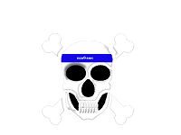
</a>

 One framework for creating powerful window games using **Stride**
 

## Overview

**mmEngine** is a shared foundation.  A reusable C# library using Stride.Community.Toolkit as its back-end.  Be warned, I do not use the preset version of 2D/3D scenes that toolkit provides.  A game brings its own rules and scenes - my engine brings everything else with Stride as the back-end (Obviously)

* Code-first, builds on Stride but does not use the editor
* Build the game, not the plumbing. Window, Material, Models, Meshes, Camera, Light, Physics, Fonts and UI are done by the engine. Create a starting menu scene and let the game begin. 
* Small reusable pieces live in the engine. A model loader, UI buttons, a 2D explosion, etc.

**mmEngine** - the shell
* Owns the Stride "Game" class, the sharedd scene, font and "GameMaterials".  On start it adds the graphics compositor with a clean UI stage, the "Main" perspective camera, a directional light and skybox.  It also registers Bepu physics.

**mmScene** - one screen at a time
* Every screen is an mmScene: a menu, options, game over, game view.  It has "Enter()", "Exit()" and "Update()" methods and nothing else to wire up.
* Each scene sets its own window/size.  The "ChangeScene() applies the window/size on entry. So, a 1000 x 700 card game table and a full 3D world can line in the same game.

**mmEcs** - Entity component System framework (small & agile)
* ECS keeps the logic findable (not hiding in the depth of every scene)
* Entity and its data (component) are your objects in the scene
* One or many Systems act on those objects by using the components.
* Initiate the EcsWorld, use "CreateEntity()" and then "Add()" it to an existing scene or other entities (Parent/Child).  Finally "DestroyEntity()" removes it with its children from scene.
* Systems do one job (keep it simple) Camera, Entity movements, Driving, Firing, Card deals, Input.  "AddSystem()" method in a scene will add that paricular logic to a given scene.
* Each system can "Query<T>()" on one or more components and find all the entities (and their children) that are affected by the logic in that system.

## Games build the scene - Stride renders It

Game code never draws anything.  It creates entities with models and transform component and the Stride compositor draws them through the "Main Camera"
* FlatQuads is for table games by building flat 3D quads and triangles for card games, tetris, topview battle games, backgammon etc.
* ModelLoader is for real models like FBX, OBJ, DAE, 3DS and many more at runtime via Assimp - One piece per mesh, textures are resolved besides the file.
* GameMaterials loads textures and materials once and "TmxMap" load Tiled maps for any game.

## UI kit has 4 pieces

Every menu and dialog in every game is built from the same 4 components.  Button, Label, Panel, MessageBox
"MenuPanel" is build on Panel.  It has Title, subTitle, stacked options and a footer in one panel.  The Panel owns hover, clicks and Keyboard selections.
"SplashScene" is a ready made cute 4 second display for banners.
"ScrollingBackground" good for any scene that wants the background to move and repeat itself.
"Options Grid" and "Popup" manager are other helpful scenes.

## Samples
 

Check out the awesome many samples.  It took sometime but they all have a lot in common.

|**Backgammon 2D**|**Battleship 2D**|
|-|-|
|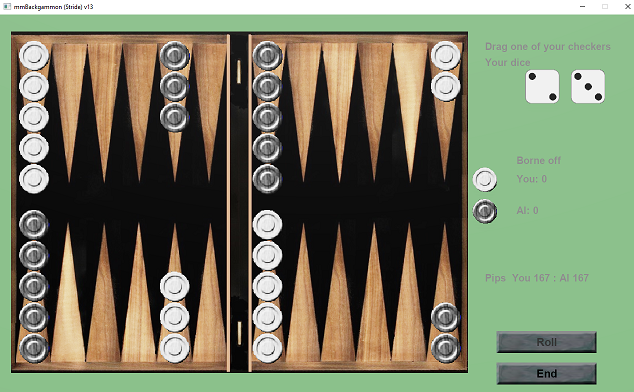|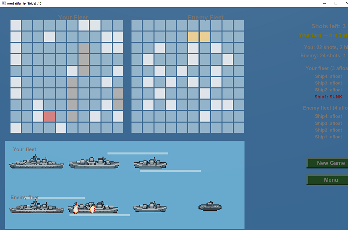|
|A real game you play vs. computer. Computer moves are slow enough to follow. 3 levels of difficulty|You start with a 4 shot salvo. You lose a shot everytime your ship sinks. Missed shots fall into water! Ships are visually on fire.|
|||

|**Blackjack 2D**|**Cannon 3D**|
|-|-|
|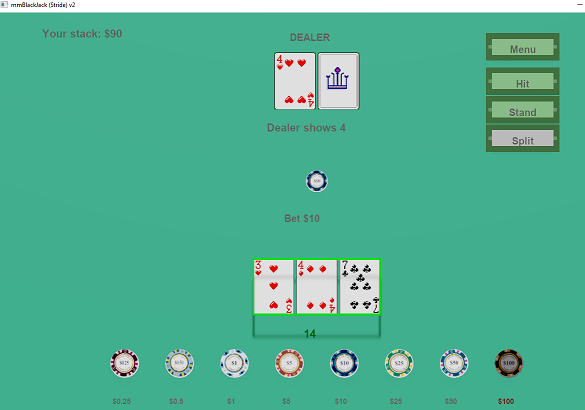|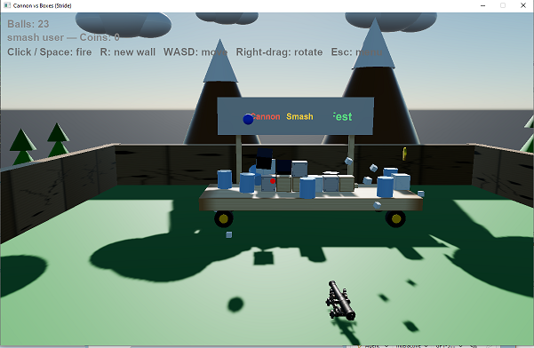|
|a 2D card game vs. computer.  Allows for splits.| You fire a cannon onto boxes of metal, wood and ice. Hit the gold coin to get extra 2 shots. WASD moves the camera around area.|
|||

|**City Center 3D**|**FPS 3D**|
|-|-|
|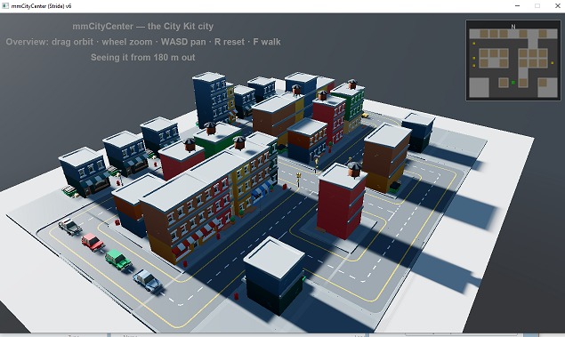|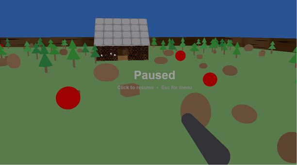|
|a 3D city with streets and cars, walk around using WASD. Run into a car and you get to drive it around using WASD.| You start in a room. Press space to open door! Use left mouse button to fire on the rocks & red targets. WASD moves you around. Go up stairs and see the entire areana|
|||

|**FBX file 3D**|**TMX Map 2D**|
|-|-|
|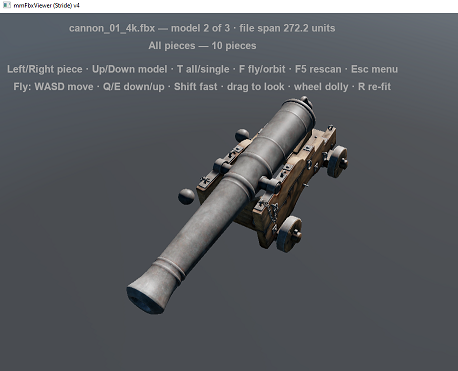|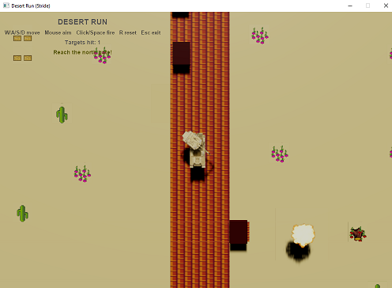|
|Move your FBX models into the Asset folder, this program will display it as a menu to look at the file.| Example reads a TMX file made used Tiled software. Places a tank and its turret to move around.|
|||

|**MIDI Piano 2D**|**Many Samples 2D/3D**|
|-|-|
|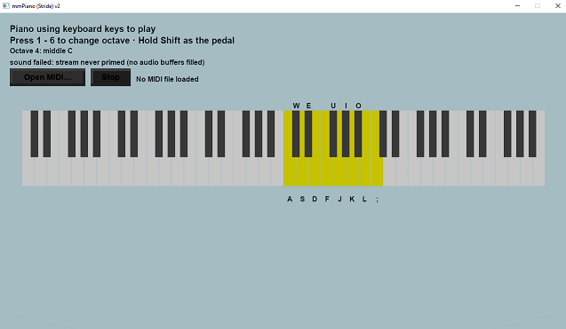|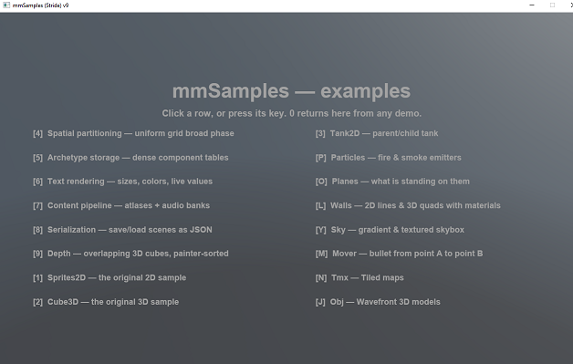|
|Play piano using Keyboard, and use shift key as a pedal ! Load a MIDI file to play. This uses MeltySynth package.| Many example on how to use the options available in this engine.|
|||

|**Solitaire 2D**|**Tank 3D**|
|-|-|
|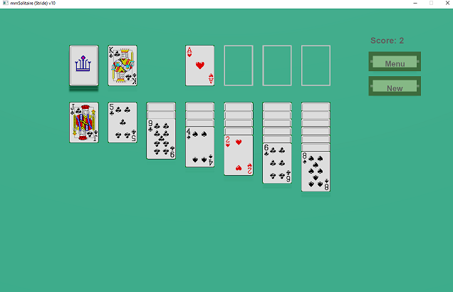|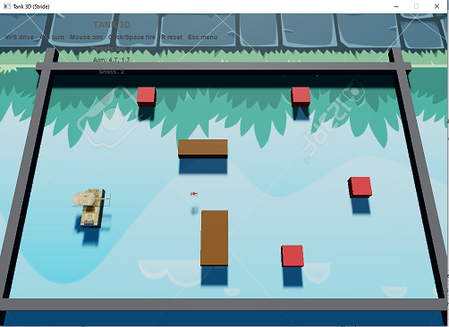|
|Play a game of solitaire. program shows you where the cards should go !| Using a 2D sprite image, we make a 3D tank that shots objects in a small areana.|
|||

|**Tank battle 2D**|**Tetris 2D**|
|-|-|
|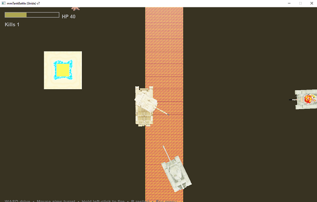|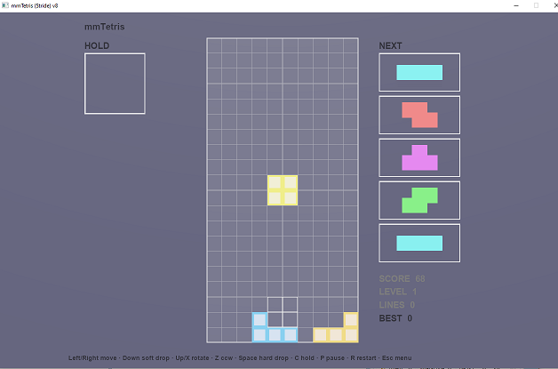|
|Using a TMX map drive your tank thru desert, while enemy tanks fire at you. Watch out for land mines!| Game of Tetris, using the arrow keys.  A few options on how to play the game.|
|||

|**Village 3D**|**mmEngine & Stride**|
|-|-|
|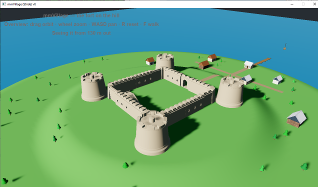|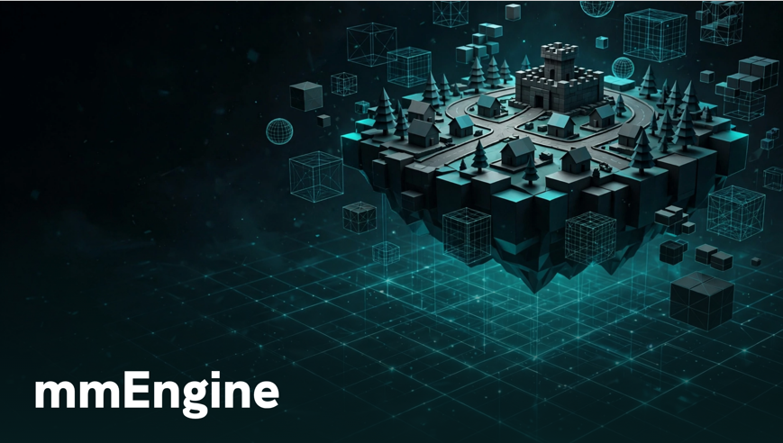|
|My favorite example, using a FBX castle with a few homes around it. Go to the top of castle and view it all.  Go to the pier and watch the boat bob in the water!| Using code-first with Stride has been a lot of fun and learning.|
|||

## Helpful Links

* [Stride](https://github.com/stride3d/stride).
* The [Stride Community Toolkit](https://github.com/stride3d/stride-community-toolkit).
* [BepuPhysics](https://github.com/bepu/bepuphysics2) 3D physics package.
* [Silk.Net](https://github.com/dotnet/Silk.NET) Assimp to read model files
* [Meltysynth](https://github.com/sinshu/meltysynth) a SoundFont MIDI synthesizer for .NET
* Entity Component System [ECS](https://en.wikipedia.org/wiki/Entity_component_system)
## License

use it all you want.  some of the images and examples were copied from other projects and fit into Stride.
