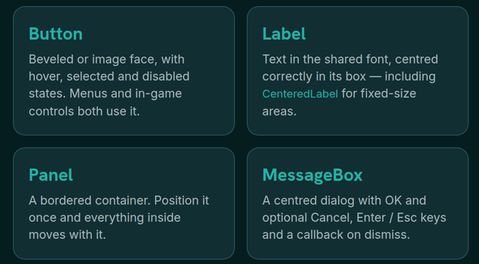

 

 One framework for creating powerful window games
 

## Overview

**mmEngine** is a shared foundation, not a game.  A reusable C# library using Stride.Community.Toolkit as its back-end.  Be warned, I do not use the preset version of 2D/3D scenes that toolkit provides.  A game brings its own rules and scenes - my engine brings everything else and Stride <Smily Face>

* Code-first, build on Stride but does not use the editor
* Build the game, not the plumbing. Window, Material, Rendering, Camera, Light, Physics, Fonts and UI are done by the engine. Create a starting menu scene and let the game begins. 
* Small reusable pieces live in the engine. A model loader, UI buttons, a 2D explosion, etc.

**mmEngineEngine - the shell**
-- Owns the Stride "Game" class, the sharedd scene, font and "GameMaterials".  On start it adds the graphics compositor with a clean UI stage, the "Main" perspective camera, a directional light and skybox.  It also registers Bepu physics.

**mmScene - one screen at a time**
-- Every screen is an mmScene: a menu, options, game over, game view.  It has "Enter()", "Exit()" and "Update()" methods and nothing else to wire up.
-- Each scene sets its own window/size.  The "ChangeScene() applies the window/size on entry. So, a 1000 x 700 card game table and a full 3D world can line in the same game.

**mmECS - keeps the logic findable (not hiding in the depth of every scene)**
-- Entity and its data (component) are your objects in the scene
-- One or many System act on those objects by using the components.
-- Initiate the EcsWorld, use "CreateEntity()" and then "Add()" it to an existing scene or other entities (Parent/Child).  Finally "DestroyEntity()" removes it with its children from scene.
-- Systems do one job (keep it simple) Camera, Entity movements, Driving, Firing, Card deals, Input.  "AddSystem()" method in a scene will add that paricular logic to a given scene.
-- Each system can "Query<T>()" on one or more components and find all the entities (and their children) that are affected by the logic in that system.

## Games build the scene - Stride renders It

Game code never draws anything.  It creates entities with models and transform component and the Stride compositor draws them through the "Main Camera"
-- FlatQuads is for table games by building flat 3D quads and triangles for card games, tetris, topview battle games, backgammon etc.
-- ModelLoader is for real models like FBX, OBJ, DAE, 3DS and many more at runtime via Assimp - One piece per mesh, textures are resolved besides the file.
-- GameMaterials loads textures and materials once and "TmxMap" load Tiled maps for any game.

## UI kit has 4 pieces

Every menu and dialog in every game is built from the same 4 components.  Button, Label, Panel, MessageBox
"MenuPanel" is build on Panel.  It has Title, subTitle, stacked options and a footer in one panel.  The Panel owns hover, clicks and Keyboard selections.
"SplashScene" is a ready made cute 4 second display for banners.
"ScrollingBackground" good for any scene that wants the background to move and repeat itself.
"Options Grid" and "Popup" manager are other helpful scenes.

## Samples

Check out the awesome [game samples](https://github.com/MonoGame/MonoGame.Samples) maintained by the MonoGame team:

|[Platformer 2D Sample](https://github.com/MonoGame/MonoGame.Samples/blob/3.8.2/Platformer2D/README.md)|[NeonShooter](https://github.com/MonoGame/MonoGame.Samples/blob/3.8.2/NeonShooter/README.md)|
|-|-|
|Supported on all platforms|Supported on all platforms|
|||
|The [Platformer 2D](https://github.com/MonoGame/MonoGame.Samples/blob/3.8.2/Platformer2D/README.md) sample is a basic 2D platformer pulled from the original XNA samples and upgraded for MonoGame.|[Neon Shooter](https://github.com/MonoGame/MonoGame.Samples/blob/3.8.2/NeonShooter/README.md) Is a graphically intensive twin-stick shooter with particle effects and save data from Michael Hoffman|
|||

|[Auto Pong Sample](https://github.com/MonoGame/MonoGame.Samples/blob/3.8.2/AutoPong/README.md)|[Ship Game 3D](https://github.com/MonoGame/MonoGame.Samples/blob/3.8.2/ShipGame/README.md)|
|-|-|
|Supported on all platforms|GL / DX / iOS / Android|
|||
|A short [sample project](https://github.com/MonoGame/MonoGame.Samples/blob/3.8.2/AutoPong/README.md) showing you how to make the classic game of pong, with generated soundfx, in 300 lines of code.|3D Ship Game (Descent clone) sample, pulled from the XNA archives and updated for MonoGame|
|||

## Support and Contributions

If you think you have found a bug or have a feature request, use our [issue tracker](https://github.com/MonoGame/MonoGame/issues). Before opening a new issue, please search to see if your problem has already been reported. Try to be as detailed as possible in your issue reports.

If you need help using MonoGame or have other questions we suggest you post on [GitHub discussions](https://github.com/MonoGame/MonoGame/discussions) page or [Discord server](https://discord.gg/monogame). Please do not use the issue tracker for personal support requests.

If you are interested in contributing fixes or features to MonoGame, please read our [contributors guide](CONTRIBUTING.md) first.

### Subscription

If you would like to help the project by supporting us financially, consider supporting us via a subscription for the price of a monthly coffee.

Money goes towards hosting, new hardware and if enough people subscribe a dedicated developer.

There are several options on our [Donation Page](https://monogame.net/donate/).

## Source Code

> [!NOTE]
> For the prerequisites to build from source, please refer to the [Requirements](REQUIREMENTS.md) file.

The full source code is available here from GitHub:

* Clone the source: `git clone --recurse-submodules https://github.com/MonoGame/MonoGame.git` (including resursive submodules).
* Set up the submodules: `git submodule update --init`
* Open the solution for your target platform to build the game framework.
* Open the Tools solution for your development platform to build the pipeline and content tools.

A high level breakdown of the components of the framework:

* The game framework is found in [MonoGame.Framework](MonoGame.Framework).
* The content pipeline is located in [MonoGame.Framework.Content.Pipeline](MonoGame.Framework.Content.Pipeline).
* Project templates are in [Templates](Templates).
* See [Tests](Tests) for the framework unit tests.
* See [Tools/Tests](Tools/MonoGame.Tools.Tests) for the content pipeline and other tool tests.
* The [mgcb](Tools/MonoGame.Content.Builder) is a command line tool for content processing.
* The [mgfxc](Tools/MonoGame.Effect.Compiler) is a command line effect compiler tool.
* The [mgcb-editor](Tools/MonoGame.Content.Builder.Editor) tool is a GUI frontend for content processing.
* (Preview) The [Content Builder Project](MonoGame.Framework.Content.Pipeline/Builder/) is a new console app framework for content processing.

## Helpful Links

* The official website is [monogame.net](http://www.monogame.net).
* Our [issue tracker](https://github.com/MonoGame/MonoGame/issues) is on GitHub.
* You can [join the Discord server](https://discord.gg/monogame) and chat live with the core developers and other users.
* The [official documentation](https://docs.monogame.net/articles/index.html) is on our website.
* Download [release](https://github.com/MonoGame/MonoGame/releases) and [development](https://github.com/orgs/MonoGame/packages) packages.
* Release and Preview releases are also available on [NuGet.Org](https://www.nuget.org/packages?q=monogame.framework&includeComputedFrameworks=true&prerel=true&sortby=relevance).
* Follow [@MonoGameTeam](https://twitter.com/monogameteam) on Twitter/X, [BlueSky](https://bsky.app/profile/monogame.net) and [Mastodon](https://mastodon.cloud/@MonoGame).
* Get premium content on [Patreon](https://www.patreon.com/bePatron?u=3142012).

## License

The MonoGame project is under the [Microsoft Public License](https://opensource.org/licenses/MS-PL) except for a few portions of the code. See the [LICENSE.txt](LICENSE.txt) file for more details. Third-party libraries used by MonoGame are under their own licenses. Please refer to those libraries for details on the license they use.
